# Лабораторная работа №4. Разработка REST API
## Цель работы
Создание Spring Boot приложения с поддержкой REST API для управления данными абитуриентов, реализация полноценных CRUD-операций, возвращающих JSON-объекты, с использованием промежуточного слоя DTO (Data Transfer Object).

## Архитектура проекта
- **Стек:** Spring Boot 3, Spring Data JPA, Hibernate Validator, Maven.
- **СУБД:** H2.
- **Основные слои:**
    - **REST Controller (Endpoints):** Класс `EnrolleeRestController`, принимающий HTTP-запросы, выполняющий валидацию и возвращающий JSON-ответы клиенту.
    - **Data Transfer Object (DTO):** Слой объектов переноса данных `EnrolleeDTO`, инкапсулирующий в плоскую структуру свойства сущностей `Enrollee` и `Address` для удобной передачи по сети.
    - **Repository (Доступ к данным):** Интерфейс `EnrolleeRepository` для выполнения SQL-запросов и поиска.
    - **Entity (Модели данных):** Сущности базы данных (`Enrollee`, `Address`, `ExamScore`).
- **Ключевые аннотации:**
    - `@RestController` - сочетает в себе `@Controller` и `@ResponseBody`, заставляя все методы возвращать JSON-данные напрямую вместо HTML-шаблонов.
    - `@RequestBody` - связывает входящий JSON-тело HTTP-запроса с Java-объектом (DTO).
    - `@ResponseStatus` - явно задает HTTP-код ответа сервера (например, `201 CREATED` или `24 NO_CONTENT`).
    - `@Valid` - запускает автоматическую проверку ограничений полей DTO при десериализации.
    - `@GetMapping`, `@PostMapping`, `@PutMapping`, `@DeleteMapping` - маппинг соответствующих HTTP-методов на endpoints контроллера.
- **Описание моделей данных и DTO:**
    - **`Enrollee` (Entity):** Системная сущность абитуриента, содержащая персональные данные, а также сложные связанные объекты `Address` (`@OneToOne`) и `ExamScore` (`@OneToMany`).
    - **`EnrolleeDTO` (DTO):** Специализированный класс-контейнер, который разворачивает сложную иерархию сущностей в плоский вид для упрощения отправки JSON-запросов и защиты от циклической рекурсии Jackson при сериализации.

## Алгоритм работы
1. **Получение списка с фильтрацией (`GET /api/enrollees`):** Клиент может передать параметры `searchType` и `keyword`. Контроллер выполняет одну из трех стратегий поиска через репозиторий (по фамилии, городу или проходному баллу). Результаты преобразуются из сущностей в список `EnrolleeDTO` через Stream API и конструктор, после чего сериализуются библиотекой Jackson в JSON-массив.
2. **Получение по ID (`GET /api/enrollees/{id}`):** Контроллер ищет абитуриента в базе. Если он отсутствует, выбрасывается `EntityNotFoundException` (что приводит к ошибке 404). При успешном поиске сущность оборачивается в DTO и отправляется клиенту с кодом `200 OK`.
3. **Создание сущности (`POST /api/enrollees`):** Клиент передает плоский JSON, который валидируется на входе. Внутри метода создается чистый объект `Enrollee` и связанный с ним `Address`. Поля из DTO вручную переносятся в сущности, после чего выполняется каскадное сохранение через `enrolleeRepository.save()`. Метод возвращает созданный объект в виде DTO со статусом `201 CREATED`.
4. **Обновление данных (`PUT /api/enrollees/{id}`):** Контроллер находит существующую запись, обновляет ее поля (и вложенные поля адреса) на основе пришедшего валидного DTO, перезаписывает объект в базе данных методом `save` и возвращает обновленный JSON-результат.
5. **Удаление записи (`DELETE /api/enrollees/{id}`):** Метод проверяет наличие ID в системе. Если запись есть, она удаляется из репозитория, а клиенту возвращается пустой ответ со статусом `24 NO_CONTENT`.

### GET-запрос: Получение полного списка абитуриентов в формате JSON
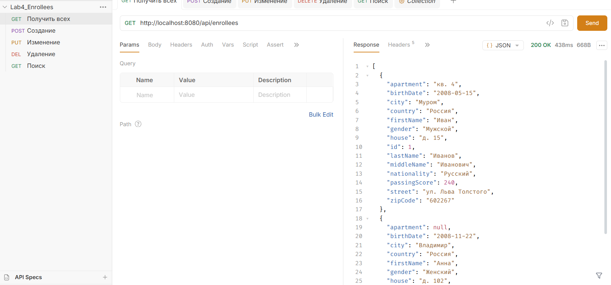

### POST-запрос: Создание нового абитуриента через отправку EnrolleeDTO (Статус 201 Created)
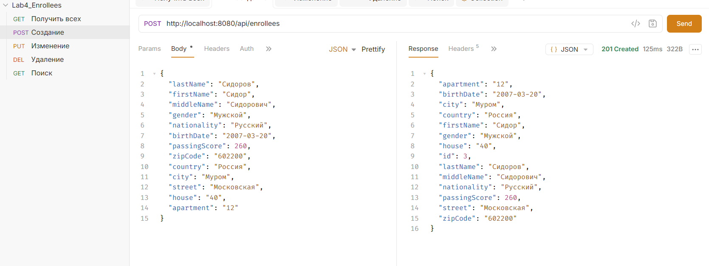

### PUT-запрос: Обновление данных существующего абитуриента по ID
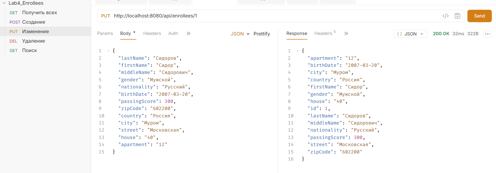

### DELETE-запрос: Удаление абитуриента из базы данных (Статус 204 No Content)
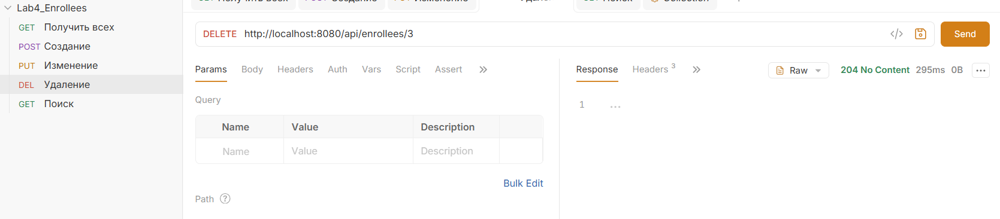

### GET-запрос с фильтрацией: Поиск абитуриентов по городу (searchType=city)
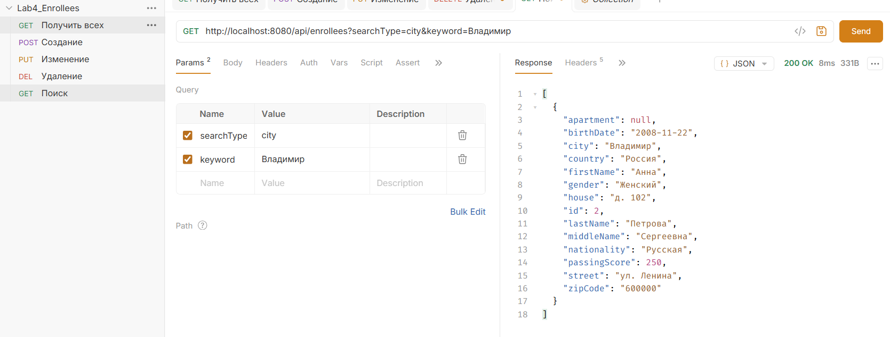

# Лабораторная работа №3. Связи между таблицами
## Цель работы
Разработать веб-приложение на базе фреймворка Spring Boot для выполнения CRUD-операций с выводом данных через шаблоны, реализовав объектно-реляционные связи (`OneToOne`, `OneToMany`, `ManyToOne`) между несколькими таблицами базы данных, а также настроить валидацию данных и поиск по нескольким критериям.

## Архитектура проекта
- **Стек:** Spring Boot 3, Spring Data JPA, Hibernate Validator, Thymeleaf, Maven.
- **СУБД:** H2
- **Основные слои:**
    - **Entity (Модели данных):** Три связанные сущности `Enrollee` (Абитуриент), `Address` (Адрес) и `ExamScore` (Оценки по экзаменам).
    - **Repository (Доступ к данным):** Интерфейс `EnrolleeRepository`, содержащий методы для поиска данных по ключевым словам.
    - **Controller (Endpoints):** Класс `EnrolleeController`, управляющий HTTP-запросами, маршрутизацией, валидацией моделей и обработкой поисковых параметров.
    - **View (Представления):** Thymeleaf-шаблоны (`main`, `edit_enrollee`, `details`) для динамического отображения списков, форм ввода и карточек сущностей.
- **Ключевые аннотации:**
    - **Аннотации связей (JPA):** `@OneToOne` (связь абитуриента и адреса), `@OneToMany` (связь абитуриента со списком оценок), `@ManyToOne` (связь оценки с абитуриентом), `@JoinColumn` (определение внешнего ключа в таблице).
    - **Аннотации валидации (Bean Validation):** `@Valid` (запуск каскадной проверки вложенных объектов), `@NotBlank` (проверка на пустые строки), `@NotNull` (обязательное заполнение поля), `@Size` (ограничение длины строки), `@Pattern` (проверка по регулярному выражению), `@Min` и `@Max` (числовые диапазоны), `@Past` (дата в прошлом).
    - **Аннотации веб-слоя:** `@Controller`, `@RequestMapping`, `@GetMapping`, `@PostMapping`, `@PathVariable`, `@ModelAttribute`, `@RequestParam` (для чтения критериев поиска в URL).

## Алгоритм работы
1. **Инициализация связей:** При старте приложения Hibernate автоматически генерирует в базе данных таблицы `enrollees`, `addresses` и `exam_scores` с учетом внешних ключей (`address_id` в таблице абитуриентов и `enrollee_id` в таблице оценок). При этом каскадность `CascadeType.PERSIST` и параметр `orphanRemoval = true` обеспечивают автоматическое сохранение или удаление зависимых сущностей (адреса и оценок).
2. **Многокритериальный отбор и вывод (`/enrollees/main`):** Метод принимает необязательные параметры `searchType` и `keyword`. Контроллер анализирует тип поиска через конструкцию `switch` и выполняет одну из трех комбинаций фильтрации:
    - По точной фамилии (`findByLastName`).
    - По городу проживания через связанную сущность (`findByAddressCity`).
    - По проходному баллу, который равен или выше указанного (`findByPassingScoreGreaterThanEqual`).
3. **Создание формы с вложенными сущностями (`/enrollees/create`):** Метод контроллера инициализирует новый объект `Enrollee` и связывает его с новым пустым объектом `Address`.
4. **Валидация и каскадное сохранение (`/enrollees/save`):** Данные формы отправляются через `POST`-запрос. Аннотация `@Valid` проверяет данные и каскадно спускается в поля объекта `Address`. Результаты проверки пишутся в `BindingResult`. Если обнаружены ошибки (например, неверный формат индекса), приложение возвращает пользователя на форму создания с выводом текстов ошибок. Если валидация пройдена успешно, объект сохраняется одной командой `enrolleeRepository.save(enrollee)`.
5. **Просмотр деталей (`/enrollees/details/{id}`):** Запись извлекается из репозитория по `id`. Hibernate автоматически подтягивает связанные данные адреса и оценок, формируя полную карточку абитуриента.
6. **Удаление сущностей (`/enrollees/delete/{id}`):** При вызове метода `deleteById`, благодаря настройкам каскадности (`orphanRemoval = true`), из базы автоматически стираются соответствующие записи из таблиц адресов и оценок, предотвращая появление "осиротевших" данных в БД.

## Скриншоты работы приложения
### Главная страница - вывод списка и панель фильтрации (поиск по 3 критериям)
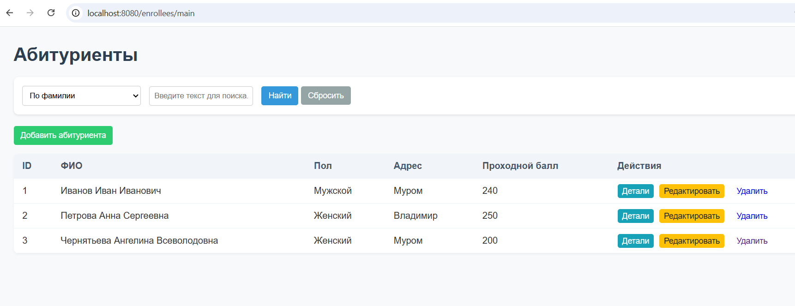
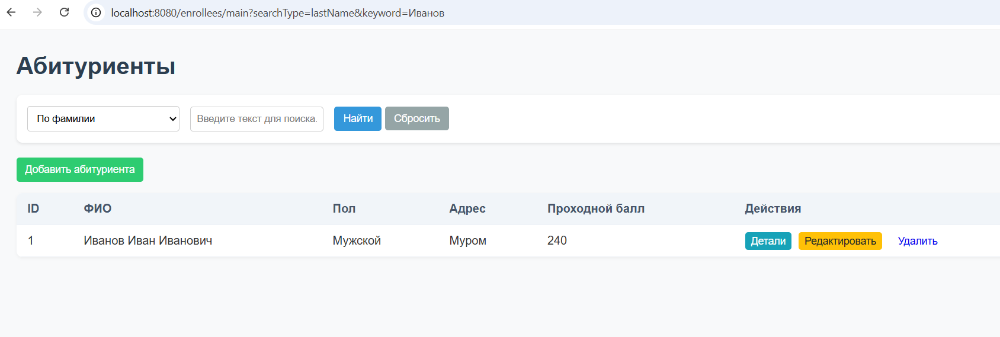
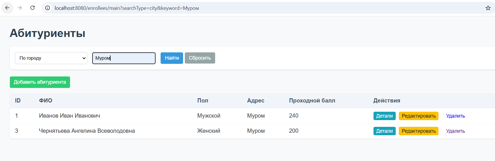
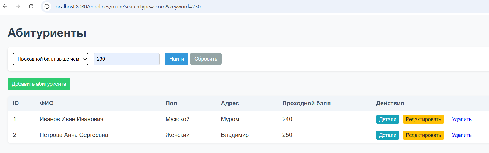

### Демонстрация работы валидации полей
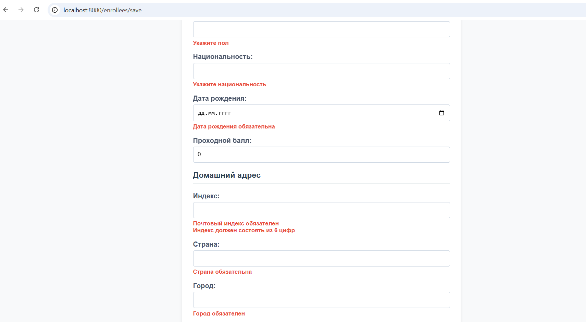
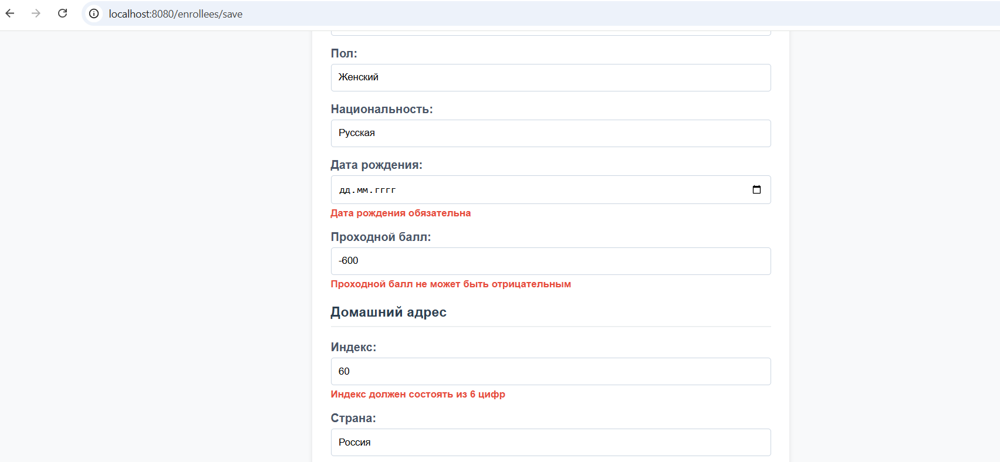

### Карточка абитуриента
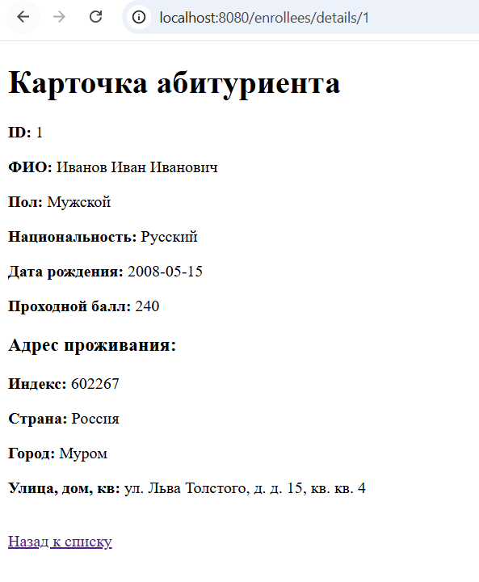

# Лабораторная работа №2. Spring Data JPA
## Цель работы
Разработать веб-приложение на базе фреймворка Spring Boot для CRUD-операций с выводом данных через шаблоны, используя Spring Data JPA для интеграции с базой данных.

## Архитектура проекта
- **Стек:** Spring Boot 3, Spring Data JPA, Maven, Thymeleaf.
- **СУБД:** H2
- **Основные слои:**
    - **Entity (модель данных):** Классы `Student` и `Enrollee` описывают структуру таблиц в базе данных.
    - **Repository (доступ к данным):** Интерфейсы `StudentRepository` и `EnrolleeRepository`, наследующие `CrudRepository` для выполнения SQL-запросов без явного написания кода.
    - **Controller (управление endpoints):** Классы `StudentController` и `EnrolleeController` обрабатывают HTTP-запросы пользователей и связывают данные из репозиториев с UI-шаблонами.
    - **View (интерфейс):** HTML-страницы Thymeleaf для визуализации данных в браузере.
- **Ключевые аннотации:**
    - `@SpringBootApplication` — конфигурация и запуск Spring Boot приложения.
    - `@Entity`, `@Table` — сопоставление Java-класса с таблицей в БД.
    - `@Id`, `@GeneratedValue` — определение первичного ключа и стратегии его генерации (Identity).
    - `@Controller` — объявление компонента Spring MVC, отвечающего за возврат представлений.
    - `@RequestMapping`, `@GetMapping`, `@PostMapping` — маппинг URL-адресов и HTTP-методов на методы контроллера.
    - `@Autowired` — автоматическое внедрение зависимостей, внедрение репозиториев в контроллеры.
    - `@PathVariable` — извлечение динамических параметров из URI.
    - `@ModelAttribute` — связывание параметров формы/запроса с объектом модели.

## Алгоритм работы
1. **Инициализация** — при старте приложения Spring Boot поднимает контекст, настраивает подключение к базе данных и выполняет SQL-скрипты для создания и первоначального наполнения таблиц `students` и `enrollees`.
2. **Просмотр списков (`/main`)** — контроллер запрашивает все сущности из базы через метод `findAll()` репозитория, добавляет их в объект `Model` и передает для рендеринга в Thymeleaf-шаблон.
3. **Просмотр деталей (`/details/{id}`)** — контроллер пытается найти запись по `id` с помощью метода `findById()`, если запись найдена, отображается страница с информацией, если нет, происходит перенаправление (redirect) на главную страницу.
4. **Добавление и редактирование (`/create`, `/update/{id}`):**
    - При добавлении создается пустой объект сущности и передается в форму.
    - При редактировании существующий объект извлекается из БД по `id`.
    - На странице отображается форма ввода данных.
5. **Сохранение изменений (`/save`)** — после отправки формы данные через `POST`-запрос попадают в контроллер, связываются в объект с помощью `@ModelAttribute` и отправляются в базу через метод `save()`, после этого пользователь перенаправляется на главную страницу.
6. **Удаление записи (`/delete/{id}`)** — контроллер проверяет существование записи по `id` через метод `existsById()`, и в случае успеха удаляет ее методом `deleteById()`, возвращая обновленный список.

## Скриншоты работы приложения

### Форма добавления/редактирования абитуриента

### Подробная информация об абитуриенте

### Главная страница студентов
